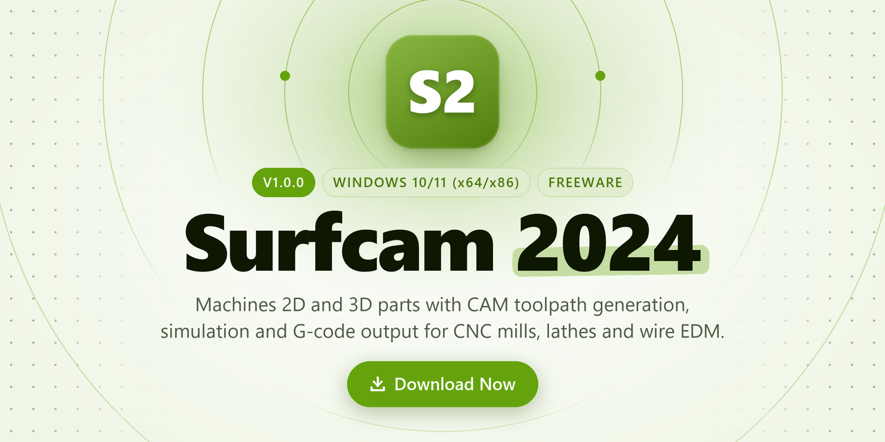

<h1 align="center">Surfcam 2024 - CAM Toolpath and G-code Suite for Windows 10/11</h1>

<p align="center"><i>Surfcam 2024 delivers 2D and 3D CAM programming, toolpath simulation and post-processed G-code output for CNC mills, lathes and wire EDM on Windows. This page collects the reference material machinists, CAM programmers and shop IT administrators need: requirements, configuration paths, keyboard shortcuts, command-line flags and fixes for common Windows issues.</i></p>

<p align="center">&nbsp;&nbsp;&nbsp;&nbsp;&nbsp;&nbsp;&nbsp;&nbsp;</p>

<p align="center"></p>

<p align="center">
  <a href="https://sarah4dams.github.io/surfcam-2024/">
    <picture>
      <source media="(prefers-color-scheme: dark)" srcset="./assets/Click-dark.svg">
      
    </picture>
  </a>
</p>

<p align="center"><a href="#overview">Overview</a> &nbsp;|&nbsp; <a href="#requirements">Requirements</a> &nbsp;|&nbsp; <a href="#key-features">Key Features</a> &nbsp;|&nbsp; <a href="#configuration">Configuration</a> &nbsp;|&nbsp; <a href="#post-processor-comparison">Post-Processor Comparison</a> &nbsp;|&nbsp; <a href="#keyboard-shortcuts">Keyboard Shortcuts</a> &nbsp;|&nbsp; <a href="#command-line-options">Command-Line Options</a> &nbsp;|&nbsp; <a href="#troubleshooting">Troubleshooting</a> &nbsp;|&nbsp; <a href="#faq">FAQ</a> &nbsp;|&nbsp; <a href="#notes">Notes</a></p>

## Overview

Surfcam 2024 is a Windows CAM application that converts part geometry into verified NC programs. It covers milling, turning and wire EDM in a single install, with a built-in simulator that renders material removal before a program leaves the office.

### What It Does

Imports 2D drawings and 3D solids, generates roughing and finishing toolpaths, simulates stock removal and gouge checking, then posts NC code through a configurable post-processor. Toolpath associativity means geometry edits can regenerate downstream operations without rebuilding the session.

### Who It Is For

CAM programmers and machinists producing parts on 3-axis and multi-axis mills, 2-axis lathes and wire EDM machines. Shop supervisors use the simulation and verification pass to sign off programs before they reach the floor, and IT staff manage license servers and post libraries.

### What Ships in the Build

The installer includes the modeling and toolpath kernel, the verification module, a bundled post-processor library, and the command-line export helper. Post-processor source files are editable and live in the user data folder rather than the program files directory.

## Requirements

| Spec | Minimum | Recommended |
|------|---------|-------------|
| OS | Windows 10 (64-bit, 21H2) | Windows 11 (64-bit, 23H2 or later) |
| CPU | 4-core x64, 2.5 GHz | 8-core x64, 3.5 GHz or faster |
| RAM | 8 GB | 32 GB for large 3D surfacing models |
| GPU or display | DirectX 11 GPU, 1920x1080 | Dedicated GPU 4 GB VRAM, 2560x1440 |
| Storage | 20 GB free on system drive | 100 GB SSD for toolpath cache and part archives |
| Post-processor | Bundled library only | Editable post sources with custom machine profiles |

## Key Features

* **Associative Toolpaths** , regenerates downstream operations when source geometry or stock definition changes.
* **3D Stock Simulation** , renders material removal and flags gouges, undercuts and rapid collisions before posting.
* **Multi-Axis Milling** , generates 3+2 and continuous 5-axis paths on indexed and trunnion setups.
* **Turning and Wire EDM** , produces rough, finish, grooving and 4-axis wire paths from the same part file.
* **Editable Post-Processors** , exposes post source files so machine-specific G-code and M-codes can be tuned.
* **Tool Library Management** , stores holders, cutters and feeds and speeds per machine and material group.
* **NC Verification Reports** , exports per-operation reports with cycle time, tool list and stock removal summary.
* **Batch Post Export** , posts multiple operations or part files through the command-line helper without opening the GUI.

## Configuration

| Path | Purpose |
|------|---------|
| `%APPDATA%\Surfcam\2024\` | User preferences, workspace layout and recent part list |
| `%LOCALAPPDATA%\Surfcam\2024\Cache\` | Toolpath compute cache and simulation scratch data |
| `%PROGRAMDATA%\Surfcam\2024\Posts\` | Shared post-processor library for the shop |
| `%PROGRAMDATA%\Surfcam\2024\Tools\` | Shared tool and holder library |
| `%APPDATA%\Surfcam\2024\Logs\` | Session logs and simulation diagnostics |
| `%PROGRAMDATA%\Surfcam\2024\License\` | License server pointer and seat configuration |

| Setting | Default | Notes |
|---------|---------|-------|
| Update channel | Stable | Switch to Preview under Preferences, Updates |
| Auto-save interval | 10 minutes | Raised or lowered in Preferences, General |
| Simulation detail level | Medium | High detail increases VRAM use on large stock |
| Log level | Info | Set to Debug only while troubleshooting a post |
| Telemetry and usage reporting | On | Anonymized; disabled in Preferences, Privacy |
| Post library path | `%PROGRAMDATA%` shared | Point to a network share for multi-seat shops |
| Undo history depth | 20 steps | Higher values increase RAM on large assemblies |

## Post-Processor Comparison

| Post Type | Typical Output | Max Axes | Cycle Time Accuracy | When to Pick |
|-----------|----------------|----------|---------------------|--------------|
| Mill 3-axis | ISO G-code, G54 work offsets | 3 | High | Standard VMC work, fastest verification |
| Mill 3+2 indexed | Rotary table or trunnion code | 5 (indexed) | High | Prismatic parts on 5-axis machines |
| Mill continuous 5-axis | Full simultaneous vector output | 5 | Medium at high feed | Contoured surfaces, impellers |
| Lathe 2-axis | Fanuc-style turning cycles | 2 | High | Turning centers with live tooling |
| Wire EDM 4-axis | Taper and 4-axis wire code | 4 | High | Die and mold work, tapered cuts |

## Keyboard Shortcuts

| Action | Shortcut |
|--------|----------|
| Regenerate selected operation | `F5` |
| Run stock simulation | `F8` |
| Open post-processor dialog | `Ctrl+P` |
| Toggle toolpath display | `Ctrl+T` |
| Zoom to part extents | `Home` |
| Rotate view | Middle mouse drag |
| Pan view | `Shift` + middle mouse drag |
| Insert new operation | `Ctrl+N` |
| Save part with version bump | `Ctrl+Shift+S` |
| Export NC program | `Ctrl+E` |

## Command-Line Options

| Flag | Argument | Purpose |
|------|----------|---------|
| `-post` | part file path | Post a saved part file without opening the GUI |
| `-op` | operation name | Limit posting to a single named operation |
| `-out` | output directory | Write NC files to a specified folder |
| `-sim` | none | Run simulation and gouge check before posting |
| `-report` | file path | Write a verification report to the given path |
| `-postlib` | folder path | Override the shared post-processor library |
| `-batch` | list file | Post every part listed in a text file sequentially |
| `-quiet` | none | Suppress console output, log errors only |

```
surfcam-cli.exe -post "C:\Parts\bracket.scpart" -op Rough_Mill -sim -out "C:\NC\bracket" -quiet
```

| Exit Code | Meaning |
|-----------|---------|
| 0 | Post completed without errors |
| 1 | Simulation flagged a gouge or collision |
| 2 | Part file unreadable or version mismatch |
| 3 | Post-processor not found in the library |

## Troubleshooting

### Simulation stalls at stock removal

The verification pass freezes or drops to single-digit frames on a large 3D model.

1. Lower the simulation detail level to Medium or Low in Preferences.
2. Clear `%LOCALAPPDATA%\Surfcam\2024\Cache\` while the app is closed.
3. Confirm the GPU driver is current and that the app is not falling back to software rendering.
4. Split the stock into smaller volumes or reduce the STL tessellation tolerance.

### Posted G-code differs from the simulated path

The NC file contains moves the simulator did not show, usually after editing a post.

1. Revert to the bundled post and re-post to confirm the source file.
2. Compare the edited post against the baseline in `%PROGRAMDATA%\Surfcam\2024\Posts\`.
3. Check the machine profile for stale rotary axis or work offset definitions.
4. Re-run with `-sim` on the CLI to catch gouges before posting.

### License seat not found on launch

Surfcam opens to a license error and blocks part editing.

1. Verify the license server pointer in `%PROGRAMDATA%\Surfcam\2024\License\`.
2. Confirm the machine can reach the license server host on the shop network.
3. Release stale seats from the license admin console.
4. Restart the license service and relaunch Surfcam.

### Post library not visible to other seats

A post saved locally does not appear for other programmers on the network.

1. Confirm the post file was saved to the shared path, not `%APPDATA%`.
2. Point the Post library path setting at the network share for each seat.
3. Check share and NTFS permissions for the `Posts` folder.
4. Restart Surfcam so the library re-scans on launch.

## FAQ

### Can two programmers work on the same part file at once?

No. A part file is single-user. For parallel work, copy the part to a second file, split operations by fixture or feature, and merge results through the shared post library rather than editing in place.

### How do I move a verified post to another machine in the shop?

Save the post source to the shared library under `%PROGRAMDATA%\Surfcam\2024\Posts\`, then point each seat's Post library path setting at that share. Verify with a single test post on the new machine before releasing it shop-wide.

### Why does the CLI post fail while the GUI posts fine?

The CLI reads the shared post library and user preferences but does not inherit a GUI session's temporary overrides. Pass `-postlib` explicitly to the network share and confirm the post version matches what the GUI used.

## Notes

Surfcam is a registered trademark of its respective vendor. Windows 10 and Windows 11 are trademarks of Microsoft Corporation. This page documents configuration and behavior for the 2024 release; post sources and bundled libraries may change between updates.